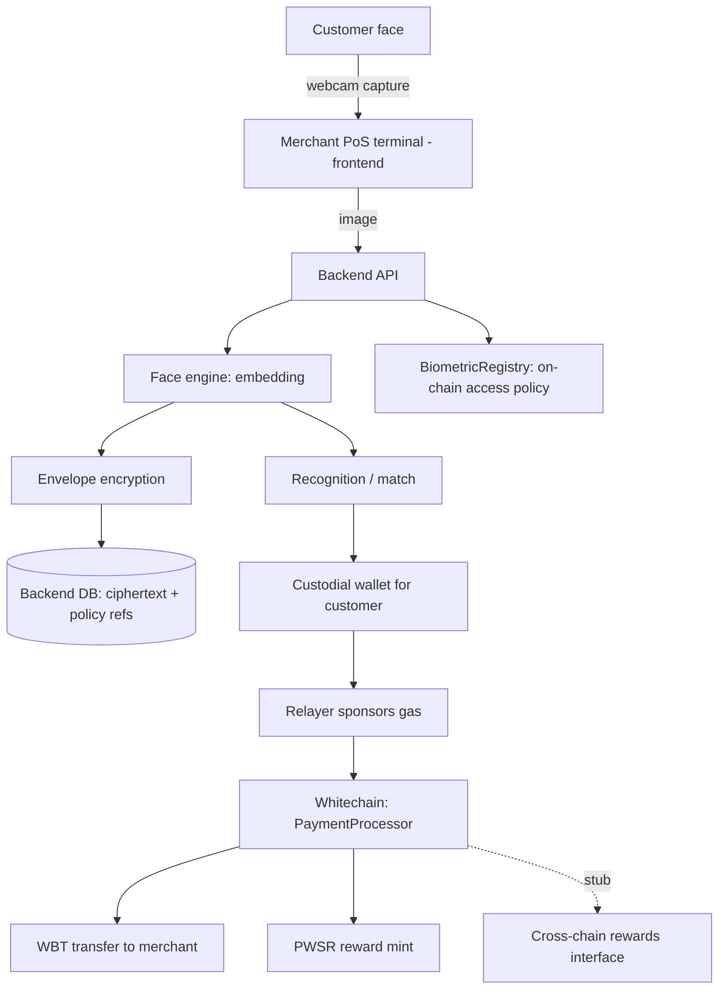

# FacePay — Project Context

> Shared context for any session working in this repo. Read this first.

## What we are building

**FacePay** is a face-biometric payment protocol and point-of-sale (PoS) system on
**Whitechain**. A customer enrolls their face once; afterwards they pay at a merchant
terminal with nothing but their face — no card, no phone, no wallet prompt. The
terminal captures a face, the backend recognizes the customer, authorizes an on-chain
payment, sponsors the gas, and mints loyalty reward tokens.


## Target chain: Whitechain

Whitechain is an **EVM-compatible OP Stack Layer 2** that settles on Ethereum and uses
**WBT** as the native gas token (18 decimals).

| Parameter | Whitechain Sepolia (dev) | Whitechain Mainnet |
| --- | --- | --- |
| Chain ID | `1874` (`0x752`) | `1875` (`0x753`) |
| RPC | `https://rpc.testnet.whitechain.io` | `https://rpc.whitechain.io` |
| WebSocket | `wss://rpc.testnet.whitechain.io/ws` | `wss://rpc.whitechain.io/ws` |
| Explorer | `https://explorer.testnet.whitechain.io` | `https://explorer.whitechain.io` |
| Faucet | `https://faucet.testnet.whitechain.io` | — |
| Gas token | WBT (native, 18 dec) | WBT |
| Block time | 1s | 1s |
| Min base fee | 5 gwei | 5 gwei |

- Solidity target: `solc 0.8.30`, `evm_version = "prague"` (highest target valid on both
  Sepolia and Mainnet).
- Predeploys: Multicall3 at `0xcA11bde05977b3631167028862bE2a173976CA11`,
  `GasPriceOracle` at `0x420000000000000000000000000000000000000F`.
- Public RPC is rate limited: 50 req/s per IP, burst 500, batch up to 100 calls.
  Batch reads via Multicall3; poll via `eth_subscribe` on `newHeads`.
- **All development targets Whitechain Sepolia (1874).**

## Architecture



## Component map

| Concern | Whitechain implementation |
| --- | --- |
| Smart contracts | Solidity, Foundry, verified on Blockscout |
| Native payment asset | **WBT** (native) — MVP is WBT-only |
| Reward token | **PWSR** ERC-20 (`PWSRToken.sol`), backend holds minter role |
| On-chain access policy + enrollment record | `BiometricRegistry.sol` (template commitment hash, fresh-nonce, TTL, verifier ACL) |
| Payment + reward atomicity | `PaymentProcessor.sol` (payable, forwards WBT to merchant, mints PWSR, emits events) |
| Encrypted biometric storage | Off-chain **envelope encryption**; ciphertext + metadata in backend DB |
| Decentralized blob store | Backend DB for MVP (IPFS is a later option) |
| Wallet / custody | **Backend-custodial EVM keypairs** (encrypted at rest); face auth authorizes signing |
| Gas sponsorship | **Backend relayer EOA pays gas** (merchant-sponsored UX) |
| Face recognition | **Open-source Python engine** (InsightFace / `face_recognition`) |
| Cross-chain rewards | **Deferred** — `ICrossChainRewards` stub interface only |
| Frontend chain SDK | `viem` + `wagmi` + Reown AppKit (merchant wallet connect) |

## Locked decisions (MVP)

1. **Custody:** backend-custodial EVM keypairs. The customer never signs on a device;
   a successful face match authorizes the backend to sign on their behalf.
2. **Gas sponsorship:** a backend relayer EOA submits and funds transactions.
3. **Payment asset:** WBT native only. ERC-20 stablecoin is a later addition.
4. **Face engine:** open-source (no paid license).
5. **Template storage:** backend relational DB (Postgres in prod, SQLite for local dev).
6. **Cross-chain:** interface stubbed now, implemented later.

## Repo layout

```
facepay/
├── CONTEXT.md            # this file
├── .gitignore            # ignores plans/, env, secrets
├── plans/                # implementation plans (git-ignored, local only)
├── contracts/            # Foundry Solidity project (PWSR, Registry, Processor)
├── backend/              # Python 3.13 (uv) API: face, crypto, chain, wallets
└── frontend/             # Next.js 16 (bun) merchant terminal + user dashboard
```

See `backend/CONTEXT.md`, `frontend/CONTEXT.md`, and `plans/` for specifics.

## Security notes

- Biometric templates are **never** stored in plaintext; only ciphertext + an on-chain
  commitment hash. Raw face images are processed in-memory and discarded.
- Custodial private keys are encrypted at rest; the encryption key lives only in env.
- Fresh-nonce + TTL on the registry prevents replay of a recognition result.
- Never commit private keys or `.env`. Use throwaway keys on testnet.
